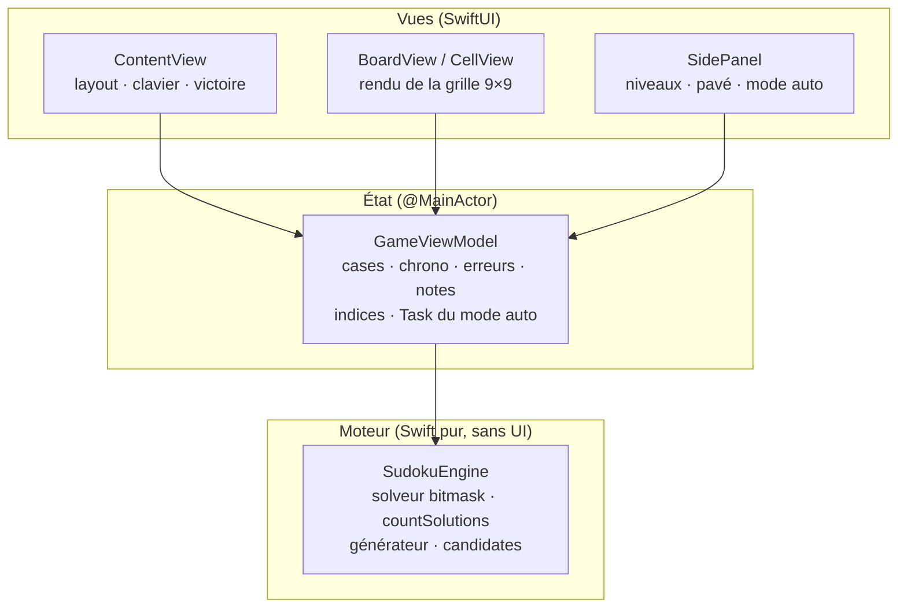

# Architecture — Sudoku pour macOS

> Miroir français. Source de vérité : [ARCHITECTURE_EN.md](ARCHITECTURE_EN.md).

## Vue d'ensemble

Application macOS native en SwiftUI pur, zéro dépendance externe, organisée en trois couches
strictes. Le projet Xcode est généré depuis `project.yml` par
[xcodegen](https://github.com/yonaskolb/XcodeGen) — le `.xcodeproj` est jetable et ignoré par git.

## Couches

### 1. Moteur — `Sources/Engine/SudokuEngine.swift`

Fonctions pures et sans état, sous namespace `enum`, sur un `[Int]` plat de 81 cases
(0 = vide). Aucun import SwiftUI — le fichier compile en standalone avec `swiftc`, ce qui sert
de smoke-test.

| API | Rôle |
|---|---|
| `solve(_:) -> [Int]?` | Solveur backtracking (MRV + bitmasks) |
| `countSolutions(_:limit:)` | Compteur de solutions avec coupure — l'oracle d'unicité |
| `generate(difficulty:)` | Grille complète aléatoire → creusage avec garantie d'unicité |
| `candidates(in:at:)` | Chiffres candidats d'une case (utilisé par l'ordre des coups du mode auto) |

Struct interne `Masks` : un bitmask `Int` par ligne/colonne/bloc ; les candidats d'une case
s'obtiennent par `~(rows | cols | boxes) & 0b1111111110`.

### 2. État — `Sources/GameViewModel.swift`

Un unique `ObservableObject` `@MainActor` portant tout l'état de la partie :

- `cells: [CellState]` — valeur, indice de départ, notes par case
- Dérivés : `conflicts` (recalculé à chaque rendu), `grid`, `formattedTime`
- Chrono via Combine (`Timer.publish`), suspendu à la victoire
- Politique d'erreur : une saisie différente de la solution stockée incrémente
  immédiatement `errorCount` (le chiffre s'affiche en rouge)
- Mode auto : une `Task` annulable — détaillée dans [docs/AUTOPLAY.md](docs/AUTOPLAY.md)

### 3. Vues — `Sources/Views/`

Rendu pur au-dessus du view model. `ContentView` gère le clavier (`.onKeyPress` : chiffres,
flèches, Suppr, `N`) et l'overlay de victoire ; `BoardView` dessine la grille avec les
surlignages pairs/même valeur/conflits ; `SidePanel` porte les niveaux, le pavé numérique, les
notes, l'indice et les contrôles du mode auto.

## Décisions clés

| Décision | Justification |
|---|---|
| `[Int]` plat (81) plutôt que `[[Int]]` | Indexation simple (`row*9+col`), copie triviale, égalité rapide |
| Solution stockée à la génération | Indices instantanés, détection d'erreur immédiate, valeurs du mode auto en O(1) |
| Unicité par comptage de solutions borné | Garantit un puzzle bien formé à tous les niveaux |
| Heuristique MRV (solveur **et** mode auto) | Recherche rapide *et* jeu d'apparence humaine avec une seule idée |
| xcodegen plutôt que `.xcodeproj` commité | Définition de projet lisible en revue, zéro conflit de merge |
| Difficulté = nombre d'indices (40/34/28/24) | Simple et prévisible ; la gradation par techniques est hors périmètre |

## Tests

`Tests/EngineTests.swift` (XCTest, hébergé dans l'app) :

- résout un puzzle de référence connu vers sa solution documentée
- rejette les grilles contradictoires
- détecte l'ambiguïté via `countSolutions`
- génère les quatre niveaux avec le bon nombre d'indices et une solution unique vérifiée
- le calcul de candidats respecte ligne/colonne/bloc
- comportement du view model : victoire sans erreur, comptage d'erreurs

## Build & release

- Debug : `xcodegen generate && xcodebuild -scheme Sudoku build`
- Release : `Scripts/release.sh` — build Release (non signé), `ditto` vers un staging propre,
  codesign Developer ID avec Hardened Runtime + timestamp, DMG dans `release/`, soumission
  `notarytool` + staple, vérification indépendante `spctl`/`stapler`.
- Icône : rendue programmatiquement par `Scripts/generate-icon.swift` (AppKit/CoreGraphics)
  → `Resources/AppIcon.icns`.
