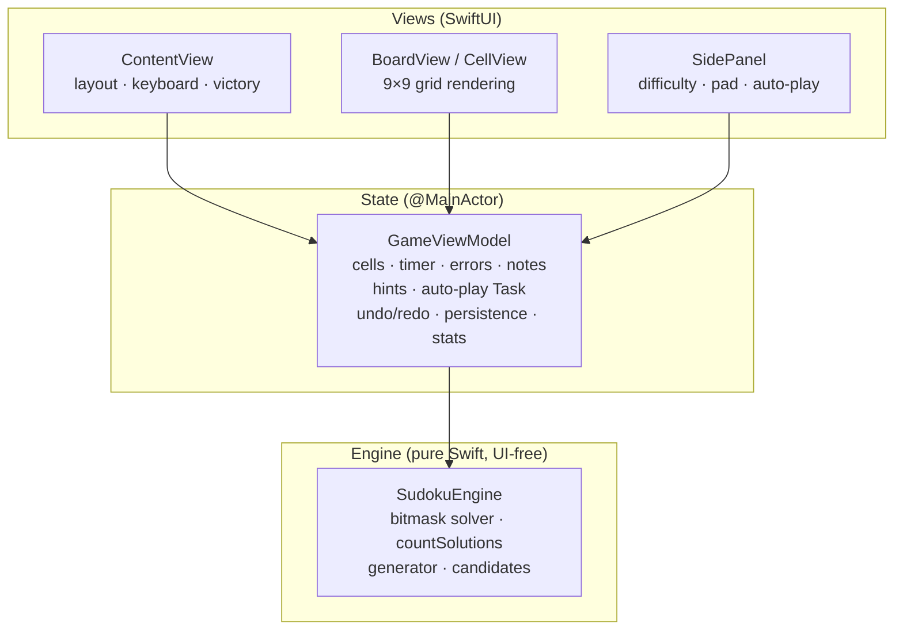

# Architecture — Sudoku for macOS

> Source of truth. French mirror: [ARCHITECTURE.md](ARCHITECTURE.md).

## Overview

A native macOS app in pure SwiftUI, organized in three strict layers, with a single external
dependency: [Sparkle 2](https://sparkle-project.org) for in-app updates (added via SPM in
`project.yml`). The Xcode project is generated from `project.yml` by
[xcodegen](https://github.com/yonaskolb/XcodeGen) — the `.xcodeproj` is disposable and
git-ignored.

## Layers

### 1. Engine — `Sources/Engine/SudokuEngine.swift`

Pure, stateless, `enum`-namespaced functions over a flat `[Int]` of 81 cells (0 = empty).
No Foundation types beyond `Array`/`Set`, no SwiftUI import — it compiles standalone with
`swiftc`, which is exactly how it is smoke-tested.

| API | Role |
|---|---|
| `solve(_:) -> [Int]?` | Backtracking solver (MRV + bitmasks) |
| `countSolutions(_:limit:)` | Solution counter with early cutoff — the uniqueness oracle |
| `generate(difficulty:)` | Full random grid → hole digging with uniqueness guarantee |
| `candidates(in:at:)` | Candidate digits for one cell (used by auto-play move ordering) |

Internal `Masks` struct: one `Int` bitmask per row/column/box; candidate lookup is
`~(rows | cols | boxes) & 0b1111111110`.

### 2. State — `Sources/GameViewModel.swift`

A single `@MainActor ObservableObject` holding the entire game state:

- `cells: [CellState]` — value, given flag, pencil marks per cell
- Derived: `conflicts` (recomputed per render), `grid`, `formattedTime`
- Timer via Combine (`Timer.publish`), paused on victory
- Error policy: an entry differing from the stored solution increments `errorCount`
  immediately (the digit renders red)
- Auto-play: a cancellable `Task` — documented in detail in
  [docs/AUTOPLAY.md](docs/AUTOPLAY.md)
- Undo/redo: snapshot stacks of `cells` (capped at 200), pushed before every board mutation;
  a new move clears the redo branch; `errorCount` is never decremented by an undo
- Persistence: the game in progress (`SavedGame`, Codable) is written to `UserDefaults` on
  every move and every clock tick, restored in `init`, and cleared on victory
- Statistics: `LevelStats` (games won, best time) per difficulty, also in `UserDefaults`;
  games finished by auto-play are excluded

### 3. Views — `Sources/Views/`

Dumb rendering over the view model. `ContentView` owns keyboard handling
(`.onKeyPress`: digits, arrows, Delete, `N`) and the victory overlay; `BoardView` draws the
grid with peer/same-value/conflict highlighting; `SidePanel` hosts difficulty buttons, the
number pad, notes toggle, hint, undo/redo (⌘Z / ⇧⌘Z), the auto-play controls, and the
per-difficulty statistics. `UpdaterCommands.swift` bridges Sparkle's `canCheckForUpdates`
into a SwiftUI menu item.

## Localization

The UI is localized in French (development language) and English via
`Resources/fr.lproj` and `en.lproj/Localizable.strings`, using semantic keys
(`difficulty.easy`, `tools.undo`, `victory.record`, …). SwiftUI `Text`/`Label`/`Button`
resolve keys implicitly through `LocalizedStringKey`; formatted strings go through
`String(localized:)` + `String(format:)`. Repository documentation stays English-only.

## In-app updates (Sparkle)

- `SPUStandardUpdaterController` started at app launch; "Check for Updates…" lives in the
  app menu (`CommandGroup(after: .appInfo)`).
- Feed: `SUFeedURL` → https://vincentlauriat.github.io/Sudoku/appcast.xml —
  `docs/appcast.xml`, served by the existing GitHub Pages site and regenerated by
  `Scripts/release.sh` at each release.
- Updates are EdDSA-signed (`sign_update`) with the private key stored in the login
  keychain under the account **"Sudoku"** — never regenerate it; the public half is
  `SUPublicEDKey` in `project.yml`.
- Sparkle compares `sparkle:version` with `CFBundleVersion` (`CURRENT_PROJECT_VERSION`),
  which must therefore increase at every release.

## Key design decisions

| Decision | Rationale |
|---|---|
| Flat `[Int]` (81) instead of `[[Int]]` | Simpler indexing (`row*9+col`), trivially copyable, fast equality |
| Solution stored at generation time | Instant hints, instant error detection, O(1) auto-play values |
| Uniqueness via capped solution counting | Guarantees a well-formed puzzle at every difficulty |
| MRV heuristic in both solver and auto-play | Fast search *and* human-looking play from one idea |
| xcodegen instead of committed `.xcodeproj` | Reviewable project definition, no merge conflicts |
| Difficulty = clue count (40/34/28/24) | Simple, predictable; harder metrics (technique-based grading) are out of scope |

## Testing

XCTest, hosted in the app — 11 tests. `Tests/EngineTests.swift`:

- solves a known reference puzzle to its documented solution
- rejects contradictory grids
- detects ambiguity via `countSolutions`
- generates all four difficulties with exact clue counts and verified unique solutions
- candidate computation respects row/column/box peers
- view-model behaviour: win detection with zero errors, error counting

`Tests/GameViewModelTests.swift` (isolated `UserDefaults` suite per test):

- undo/redo round trip, redo branch invalidated by a new move
- save/restore across view-model instances
- victory records statistics and clears the saved game

## Build & release

- Debug: `xcodegen generate && xcodebuild -scheme Sudoku build`
- Release: `Scripts/release.sh` — Release build (unsigned), `ditto` to clean staging,
  Sparkle.framework nested binaries signed deepest-first, Developer ID codesign with
  Hardened Runtime + timestamp, DMG in `release/`, `notarytool` submit + staple,
  EdDSA `sign_update` + `docs/appcast.xml` generation, independent `spctl`/`stapler`
  verification.
- App icon: rendered programmatically by `Scripts/generate-icon.swift` (AppKit/CoreGraphics)
  → `Resources/AppIcon.icns`.
