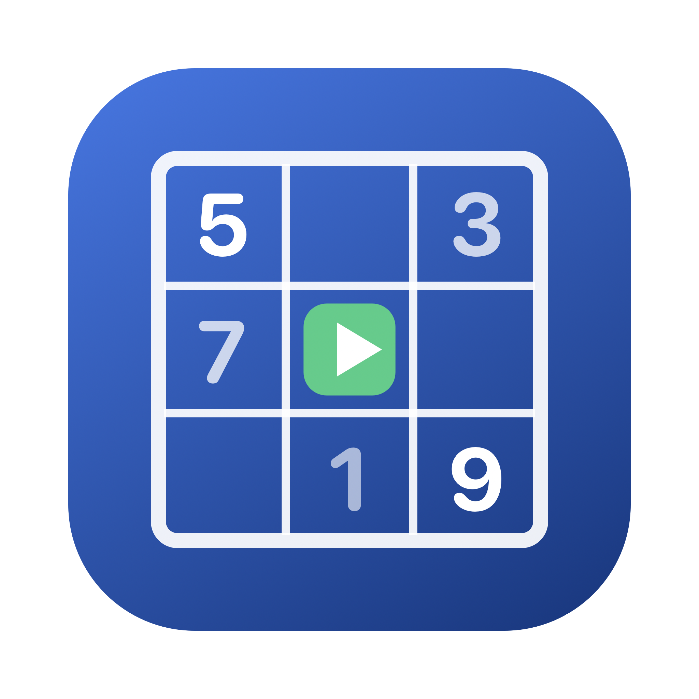
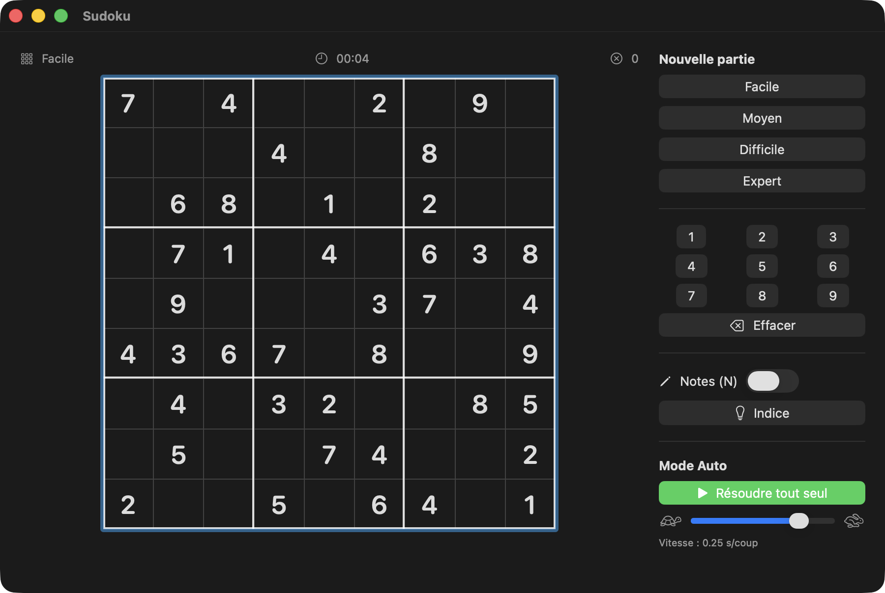

<p align="center">
  
</p>

<h1 align="center">Sudoku for macOS</h1>

<p align="center">
  A native macOS Sudoku game written in pure SwiftUI — with four difficulty levels and a
  <strong>watch-it-solve-itself</strong> auto-play mode.
</p>

<p align="center">
  <a href="https://github.com/vincentlauriat/Sudoku/releases/latest"></a>
  
  
  
  <a href="LICENSE"></a>
</p>

<p align="center">
  
</p>

This repository is meant as an **example project**: a complete, documented, tested macOS app
small enough to read in one sitting, but real enough to ship — generated puzzles with a
guaranteed unique solution, a fast bitmask solver, an animated auto-solver, unit tests, and a
signed & notarized release pipeline.

## Features

| Feature | Description |
|---|---|
| 🎚️ Four difficulty levels | Easy (40 clues), Medium (34), Hard (28), Expert (24) |
| ✅ Unique solutions | Every generated puzzle is verified to have exactly one solution |
| 🤖 **Auto-play mode** | The app solves the board by itself, cell by cell, at an adjustable speed — [how it works](docs/AUTOPLAY.md) |
| ⌨️ Full keyboard support | Digits 1–9, arrow keys, Delete, N for notes |
| ✏️ Pencil marks | Toggleable notes mode, auto-cleared as peers get solved |
| 🔍 Smart highlighting | Row/column/box peers, same-value cells, conflicts in red |
| 💡 Hints | Fills the selected (or a random) cell with the correct digit |
| ⏱️ Timer & error counter | Wrong entries are shown in red and counted |
| 🧪 Unit tests | Engine correctness: solving, uniqueness, generation, candidates |

## Install

Download the latest signed & notarized DMG from the
[Releases page](https://github.com/vincentlauriat/Sudoku/releases/latest), open it and drag
**Sudoku.app** to Applications.

## Build from source

Requires Xcode 15+ and [xcodegen](https://github.com/yonaskolb/XcodeGen) (`brew install xcodegen`).

```bash
git clone https://github.com/vincentlauriat/Sudoku.git
cd Sudoku
xcodegen generate
open Sudoku.xcodeproj   # then ⌘R
```

Run the tests:

```bash
xcodebuild test -project Sudoku.xcodeproj -scheme Sudoku -destination 'platform=macOS'
```

## How the auto-play mode works (short version)

1. **The solution is known before you play.** The generator first builds a complete valid grid
   with randomized backtracking, then removes cells one by one — keeping a removal only if the
   puzzle still has exactly one solution (checked by a solution-counting solver capped at 2).
2. **Auto-play replays that solution like a human would.** Instead of filling cells left to
   right, it repeatedly picks the empty cell with the *fewest remaining candidates* (the MRV
   heuristic — the same "look for a cell where only one digit fits" strategy human players use),
   fills in the correct digit, waits `speed` seconds, and repeats. Wrong entries made by the
   player are corrected first.
3. Everything runs in a cancellable Swift `Task`, so you can pause/resume at any time and drag
   the speed slider from 🐢 1 s/move to 🐇 0.05 s/move live.

The full write-up — bitmask solver internals, uniqueness proof, move ordering, animation loop —
is in **[docs/AUTOPLAY.md](docs/AUTOPLAY.md)**.

## Documentation

| Document | Contents |
|---|---|
| [docs/AUTOPLAY.md](docs/AUTOPLAY.md) | Deep dive: how the app plays by itself |
| [ARCHITECTURE_EN.md](ARCHITECTURE_EN.md) | Technical architecture (source of truth) |
| [ARCHITECTURE.md](ARCHITECTURE.md) | Architecture technique (miroir en français) |
| [docs/USER_GUIDE.md](docs/USER_GUIDE.md) | Functional documentation: rules, controls, modes |

## Project layout

```
Sudoku/
├── project.yml              # xcodegen project definition (the .xcodeproj is generated)
├── Sources/
│   ├── SudokuApp.swift      # @main entry point
│   ├── GameViewModel.swift  # game state, timer, errors, hints, auto-play loop
│   ├── Engine/
│   │   └── SudokuEngine.swift  # pure logic: bitmask solver, uniqueness, generator
│   └── Views/
│       ├── ContentView.swift   # window layout, keyboard handling, victory overlay
│       ├── BoardView.swift     # 9×9 grid + cell rendering
│       └── SidePanel.swift     # difficulty, number pad, tools, auto-play controls
├── Tests/
│   └── EngineTests.swift    # engine + view-model unit tests
├── Resources/               # app icon (.icns + source PNG)
├── Scripts/
│   ├── generate-icon.swift  # renders the app icon programmatically (CoreGraphics)
│   └── release.sh           # build → sign → DMG → notarize → staple
└── docs/                    # documentation + GitHub Pages landing page
```

## Roadmap

- [ ] Save/restore game in progress
- [ ] Statistics (best times per difficulty)
- [ ] Undo/redo
- [x] App icon
- [x] Signed & notarized DMG release

## License

[MIT](LICENSE) © Vincent Lauriat
