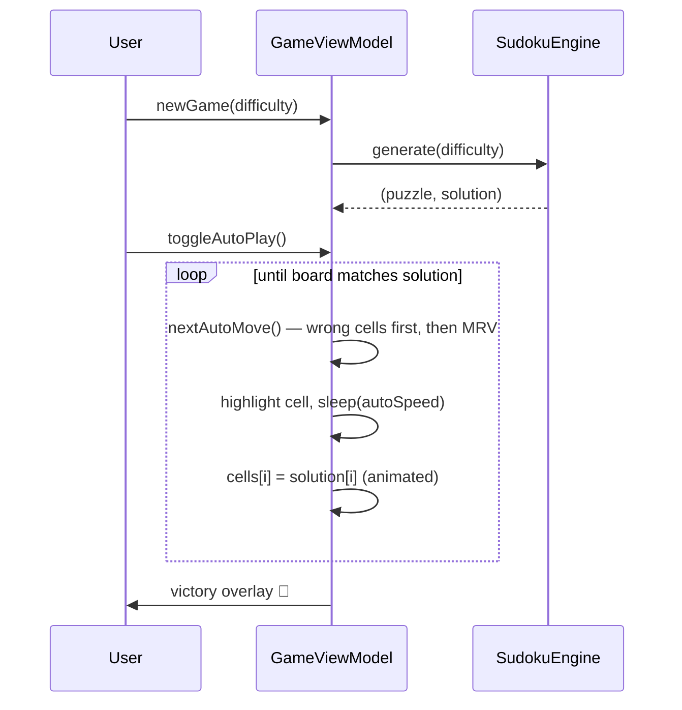

# How the app plays by itself — Auto-play deep dive

The signature feature of this project is the **Auto** mode: press *Solve by itself* and the app
fills the board cell by cell, visibly, at an adjustable speed, until the puzzle is done. This
document explains exactly how that works, from the data structures up to the animation loop.

Everything lives in two files:

- [`Sources/Engine/SudokuEngine.swift`](../Sources/Engine/SudokuEngine.swift) — pure, UI-free logic
- [`Sources/GameViewModel.swift`](../Sources/GameViewModel.swift) — the auto-play loop

## 1. The trick: the solution is computed before you ever play

Auto-play does **not** solve the puzzle live. It doesn't need to — the generator produced the
solution in the first place and the view model kept it:

```
generate(difficulty:) ──► (puzzle, solution)   // both stored by GameViewModel
```

The generator works in two phases:

### Phase A — build a full valid grid

`fillRandom` runs a backtracking pass over the 81 cells in order, trying the digits **1–9 in a
shuffled order** at each cell. Shuffling is what makes every game different; backtracking is what
guarantees the grid is complete and valid.

### Phase B — dig holes, but never break uniqueness

Cells are then cleared one by one, in random order. After each removal the engine asks:
*does this puzzle still have exactly one solution?*

```swift
puzzle[index] = 0
if countSolutions(puzzle) == 1 {
    clues -= 1          // keep the hole
} else {
    puzzle[index] = saved  // put the digit back
}
```

`countSolutions` is the solver run in counting mode, **capped at 2**: it aborts as soon as a
second solution is found, so the uniqueness check stays fast. Removal stops when the difficulty's
clue target is reached:

| Difficulty | Clues kept |
|---|---|
| Easy | 40 |
| Medium | 34 |
| Hard | 28 |
| Expert | 24 |

This is why the app can *always* auto-play flawlessly: by construction there is exactly one
solution, and it is already in memory.

## 2. The solver: bitmasks + MRV

The solver used for the uniqueness check (and available for hints/candidates) is a classic
backtracking solver made fast by two ideas:

**Bitmask bookkeeping.** For each row, column and 3×3 box, one `Int` holds a bit per digit
already placed there. The candidates of a cell are then a single expression:

```swift
free = ~(rows[r] | cols[c] | boxes[b]) & 0b1111111110   // bits 1...9 still available
```

Placing or removing a digit is one OR/AND — no scanning of 20 peer cells.

**MRV — Minimum Remaining Values.** Instead of recursing on the first empty cell, the solver
always picks the empty cell with the **fewest candidates** (`bestEmptyCell`). If any cell has
zero candidates the branch is dead and gets pruned immediately; if a cell has exactly one
candidate it is played without branching. This ordering collapses the search tree — generating
and uniqueness-checking a full Expert puzzle takes a few milliseconds.

## 3. Move ordering: why the auto-play looks human

If auto-play filled cells top-left to bottom-right it would look like a printer. Instead, each
move is chosen by `nextAutoMove()`:

```swift
private func nextAutoMove() -> Int? {
    // 1. Fix the player's mistakes first.
    if let wrong = (0..<81).first(where: { cells[$0].value != 0 && cells[$0].value != solution[$0] }) {
        return wrong
    }
    // 2. Otherwise: the empty cell with the fewest candidates right now.
    let empties = (0..<81).filter { grid[$0] == 0 }
    return empties.min { candidates(at: $0).count < candidates(at: $1).count }
}
```

Rule 2 is the same MRV heuristic as the solver — and it happens to be exactly how humans play:
scan for a cell where only one digit can go (a *naked single*), play it, and let that placement
unlock the next one. The result is an organic-looking cascade: the solver appears to "reason"
around the board rather than sweep it.

Rule 1 makes the mode robust: if you made wrong entries before pressing play, the solver
visibly corrects them before continuing.

Note the asymmetry that keeps the UI instant: choosing *which* cell to play uses live candidate
computation, but the *value* played is a lookup into the precomputed `solution` array.

## 4. The animation loop

Auto-play is a plain cancellable Swift concurrency `Task` owned by the `@MainActor` view model:

```swift
autoTask = Task { [weak self] in
    while let self, !Task.isCancelled {
        guard let i = self.nextAutoMove() else { break }   // board complete
        self.selected = i                                   // highlight the cell first…
        try? await Task.sleep(for: .seconds(self.autoSpeed))
        withAnimation(.easeOut(duration: 0.15)) {           // …then play the digit
            self.cells[i].value = self.solution[i]
        }
        self.checkWin()
    }
    self?.isAutoPlaying = false
}
```

Design points:

- **Highlight-then-fill.** The selection ring moves to the target cell *before* the pause, so
  the viewer's eye is guided to where the next digit will appear — the same "look, then write"
  rhythm as a human player.
- **Live speed control.** `autoSpeed` is read inside the loop on every iteration, so dragging
  the slider (1 s/move → 0.05 s/move) takes effect on the very next move, no restart needed.
- **Pause = cancellation.** The pause button calls `autoTask?.cancel()`. `Task.sleep` throws on
  cancellation, the loop exits, state stays consistent, and pressing play again simply starts a
  new task from the current board.
- **Termination.** The loop ends when `nextAutoMove()` returns `nil` (no wrong and no empty
  cells) — at which point `checkWin()` has already flipped the victory overlay.
- **Input lockout.** While `isAutoPlaying` is true, manual input (`select`, `enter`, `erase`,
  `hint`) is ignored, so the player and the robot never fight over the board.

## 5. Sequence overview



## 6. Trying it yourself

1. Launch the app, pick any difficulty.
2. Optionally play a few digits — even wrong ones.
3. Press **Solve by itself** and drag the speed slider while it runs.
4. Press **Pause**, play a cell manually, resume: the solver adapts to the new board state,
   because every `nextAutoMove()` decision is recomputed from the live grid.
